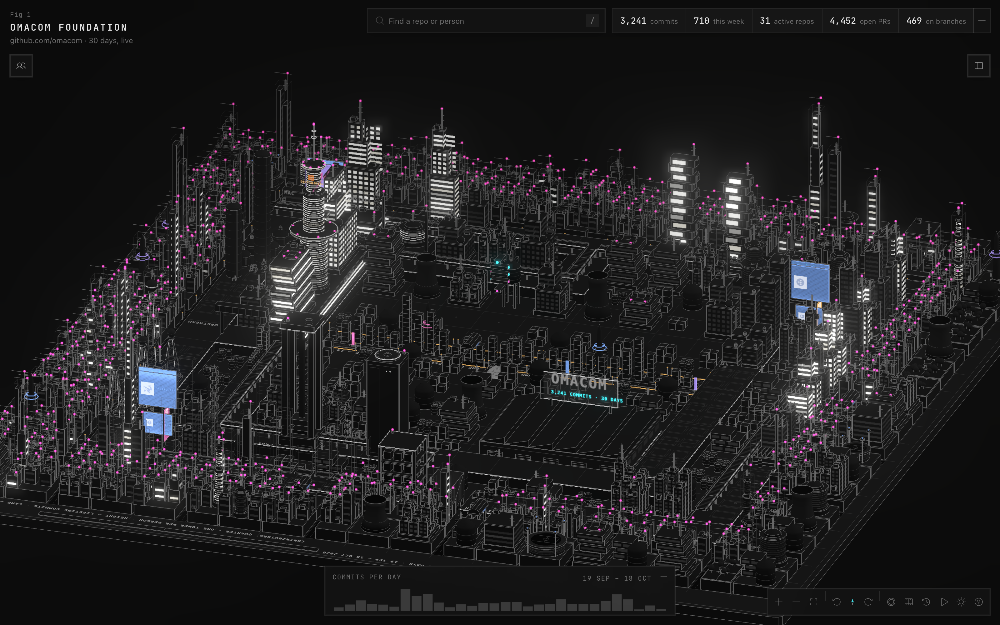

# Omaville

The [omacom](https://github.com/omacom) GitHub org drawn as a living 3D city on the Omarchy mark.



Every repository is a building, and every contributor has a tower.

- **Height is history:** a building's height follows its lifetime commits, on one scale for the whole city.
- **Light is now:** lit windows, lamps, belts and drones follow the last 7 days.
- **Position is permanent:** a new repository claims a free lot and rises out of scaffolding, and nothing that already stands moves.

The city updates live from GitHub webhooks. You can replay the last 30 days, record a clip, or take a tour of the busiest stations. Org members can sign in to see the members' city, with private repositories, teams and Basecamp projects.

## Run it

```sh
pnpm install
pnpm dev
```

The city opens on http://localhost:8080. Without a token it draws from `dev/snapshot.json`; with `GITHUB_TOKEN` set it scans the org. Without `DATABASE_URL` it runs on an in-memory database, or run `pnpm db:start` for Postgres in Docker.

| Command | What it does |
| --- | --- |
| `pnpm dev:members` | the members' city, with invented data, signed in as "you" |
| `pnpm test` | the relay's tests, a build and the privacy test |
| `node scripts/check.mjs` | draws the city from every angle and fails on bad values |
| `pnpm shots` | screenshots of the built app in both themes (`-- --gpu --scale 2` for the GPU at retina size) |

Every environment variable is listed in [.env.example](.env.example). Copy it to `.env`; local work needs none of them.

## Deploy

The app is a single Node server that needs a Postgres database. It runs on any host that runs Docker containers or Node 24.

1. Create a Postgres database.
2. Run the app with its [Dockerfile](Dockerfile), which listens on port 3000 and serves its health check at `/status`. Without Docker, run `pnpm build` and then `node build`.
3. Set `DATABASE_URL`, `ORIGIN` (the city's public address), `GITHUB_TOKEN` and `CITY_SNAPSHOT_TOKEN`. The app migrates the database on start and scans the org every hour.
4. Put it behind HTTPS at your domain.
5. Optionally, add an org webhook at `https://<domain>/hook` with `CITY_WEBHOOK_SECRET`, so the city updates within seconds.
6. Optionally, run `POST /backfill` once with the snapshot token to load the org's history for the replay and the year film.

The public city needs only a token that reads public repositories, such as a fine-grained token with public repository access. The members' city stays off until sign-in is set up: it needs `BETTER_AUTH_SECRET`, GitHub and Basecamp OAuth apps, and an org owner's token. [.env.example](.env.example) explains each one.

## Make it your org's

Everything about the org lives in one file, [city.config.json](city.config.json): the org's name, which repositories take the landmark slots, and how districts match repositories. Only `org` is required. The repositories, people, activity and layout come from GitHub and are kept in the database, so positions survive every scan and deploy.

## More

[AGENTS.md](AGENTS.md) describes how the app works inside: the relay and its event log, the layout rules, the renderer and the visual style.
